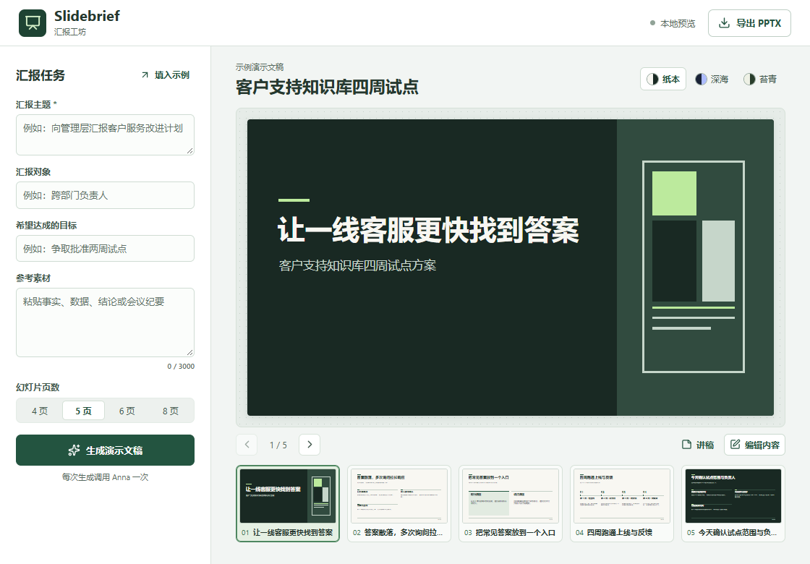

# Slidebrief · 汇报工坊

Slidebrief 帮助需要准备项目进展、复盘和方案汇报的用户，把零散材料整理为可以继续编辑的 PowerPoint。汇报目标和听众会影响内容取舍，内置示例可直接体验预览、编辑、换主题和下载。

| Anna App | 信息 |
| --- | --- |
| App name | `Slidebrief · 汇报工坊` |
| Slug | `slidebrief-studio` |
| Anna 标识 | `@xiaolin/slidebrief-studio` |
| 版本 | `1.1.0` |



## 体验流程

1. 在 [Anna staging](https://staging.anna.partners) 的应用中心安装并打开 Slidebrief。也可在 Anna 聊天中通过 `#` 选择已安装的 Slidebrief，请它打开工作区并带入 brief。
2. 填写主题，选择 4、5、6 或 8 页。补充听众、汇报目标和参考资料，可以让结论与素材更贴合实际。
3. 应用先为每页安排结论、版式和参考原文，再成稿。独立审稿会核对数字、统计口径、目标与实际结果，并结合字号和溢出检查，定向修订有问题的页面。
4. 生成后逐页检查。打开「讲稿」可查看对应的参考原文。可以直接编辑文字和讲稿、更换主题，也可用一条修改要求让 Anna 重写当前页。待核对事项会标明页码。
5. 下载 `.pptx`，用 PowerPoint 或 WPS 打开。指标、时间线、决策项等均由可编辑的 PowerPoint 文本和形状组成，演讲备注也写入文件。

## Anna 集成和额度

应用通过 Anna App Runtime 的 `llm.complete` 请求 Claude Sonnet 5 提纲、成稿和修订，并请求 Claude Opus 5 审稿。用户在 Anna 保存的模型偏好优先。通常调用 3 次。成稿格式无效时最多重试一次，审稿有问题时最多定向修订和复核两轮。单页手动改写调用 1 次。应用显示 Anna 报告的实际用量。示例、手动编辑、切换主题和 PPTX 导出在浏览器内完成。 [Anna LLM API](https://staging.anna.partners/developers/apps/llm-and-agent)

## 本地运行

需要 Node.js 22 或更新版本。

```sh
npm ci
npm run dev
npm test
npm run validate
```

本地页面可体验内置示例、编辑和导出。Anna AI 生成功能在 Anna 应用窗口中运行。`npm run validate` 构建 `bundle/` 并通过 Anna 官方 CLI 检查应用清单和构建产物。

## 上传和发布

1. 用已验证邮箱的账号登录 [Anna 开发者控制台](https://staging.anna.partners/developer)，阅读并接受开发者条款，激活开发者访问权限并设置 handle。应用以 `@handle/slidebrief-studio` 标识。 [开发者验证](https://staging.anna.partners/developers/reference/verified-developer)
2. 在项目目录运行以下命令，按 CLI 提示在浏览器授权登录，随后上传工作草稿。

```sh
npm run validate
npx anna-app login --host https://staging.anna.partners --no-browser
npx anna-app whoami
npx anna-app apps push --account https://staging.anna.partners
```

3. 在开发者控制台打开该应用，安装并试用版本 `0.0.0-draft`。验证示例、编辑和导出后，使用内置「客户支持知识库四周试点」的 brief，选择 4 页并发起一次 AI 生成。检查页数、标题与要点、材料中的数字是否仍明确标为目标或计划、演讲备注和可编辑的 PPTX，并记录平台返回的额度消耗。按需再验证一次单页重写。
4. 用已验证的草稿创建版本并提交审核。

```sh
npx anna-app apps cut 1.1.0 --account https://staging.anna.partners
npx anna-app apps submit-review --account https://staging.anna.partners
```

5. 审核通过后发布版本，随后在应用中心验证安装与打开状态。公开入口为 `https://staging.anna.partners/store/@<handle>/slidebrief-studio`。若平台在批准时同时发布，直接核查 `PUBLISHED` 状态即可。 [发布流程](https://staging.anna.partners/developers/apps/app-publish)

```sh
npx anna-app apps release 1.1.0 --account https://staging.anna.partners
npx anna-app apps status slidebrief-studio --account https://staging.anna.partners
```

## 验证记录

本地通过 Anna CLI 严格校验和自动测试。测试覆盖提纲引用、独立审稿、定向修订及失败回退。PowerPoint 渲染了新版 3 套主题的 15 页测试样片，并通过文本框溢出检查。

上一版以 `qwen3.8-flash` 在 Anna staging 生成了 4 页「客户支持知识库四周试点」，消耗 0.353 CU。新版增加了项目进展实测与目标、无量化数据的事故复盘、采购方案比较三组回归场景。回归脚本记录每阶段的实际模型和 CU，并检查来源、PPTX 页数、可编辑文本和讲稿。运行下列命令会使用已登录账号的 Anna staging 额度。

```sh
node scripts/staging-quality.mjs --run --max-calls 8
```

新版回归的实际模型为 Claude Sonnet 5 和 Claude Opus 5。三个最终样片都通过结构和内容断言，审稿结果没有遗留意见。进展样例保留 18% 为实测、25% 为目标，消耗 19.03 CU。复盘样例经过两轮修订，未把没有提供的负责人、日期或影响数量写成事实，消耗 56.47 CU。采购样例保留 12 万元一次性报价与 3 万元/月的计费口径，消耗 38.73 CU。加上开发中用于诊断的回归尝试，本轮测试共消耗 199.32 CU。

公开安装须通过 Anna 审核。 [应用商店入口](https://staging.anna.partners/store/@xiaolin/slidebrief-studio)
